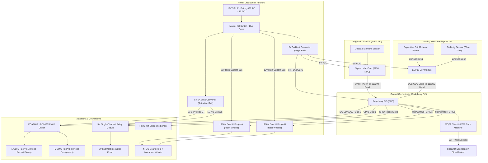

# CHIP TO CROP 2.0 — PrecisionRover Engineering Master

Comprehensive workspace, system architecture, and development tracker for the "PrecisionRover" autonomous agricultural robotics platform built for the **CHIP TO CROP 2.0** hackathon.

---

## System Architecture

PrecisionRover employs a decoupled three-tier compute and sensing architecture designed to isolate time-critical analog sampling, high-speed vision inference, and high-level autonomous kinematics and coordination.

### Hardware & Data Flow Map



### Decoupled Software Architecture

```
+-----------------------------------------------------------------------------+
|                           RASPBERRY PI 5 (Host)                            |
|                                                                             |
|  +------------------------+  +-------------------+  +--------------------+  |
|  |     MaixCam UART       |  |  ESP32 USB-Serial |  | Ultrasonic Thread  |  |
|  |    Listener Thread     |  |  Listener Thread  |  |  (Obstacle Avoid)  |  |
|  +-----------+------------+  +---------+---------+  +---------+----------+  |
|              |                         |                      |             |
|              | (Vision Commands)       | (JSON Telemetry)     | (Distance)  |
|              v                         v                      v             |
|  +-----------------------------------------------------------------------+  |
|  |                  CENTRAL FINITE STATE MACHINE (FSM)                   |  |
|  |       [IDLE] -> [NAV_SEARCH] -> [ALIGNING] -> [SAMPLING] -> ...       |  |
|  +-----------------------------------------------------------------------+  |
|              |                         |                      |             |
|              v                         v                      v             |
|  +------------------------+  +-------------------+  +--------------------+  |
|  | Mecanum Kinematics Engine |  | Actuator Controller|  |  MQTT Telemetry   |  |
|  |  (L298N GPIO PWM Dir)  |  | (PCA9685/Relay)   |  |   Publisher Hub    |  |
|  +------------------------+  +-------------------+  +--------------------+  |
+-----------------------------------------------------------------------------+
```

1. **Raspberry Pi 5 (Central Orchestrator):**
   * Acts as master controller and state arbiter.
   * Runs asynchronous listener threads for incoming UART from MaixCam and USB Serial from ESP32.
   * Calculates Mecanum inverse kinematics and outputs direction and PWM signals to two L298N motor drivers.
   * Controls the PCA9685 via I2C for probe vertical articulation, triggers the 5V water pump relay, and publishes unified telemetry to MQTT.
2. **MaixCam (Vision Edge Node):**
   * Dedicated NPU edge device running K230-accelerated YOLO / OpenCV color-space tracking.
   * Offloads image processing completely from the Pi 5.
   * Calculates crop centroid offsets and streams discrete ASCII directives (`STRAFE_LEFT`, `STRAFE_RIGHT`, `ALIGNED_STOP`) over 115200 baud UART.
3. **ESP32 (Analog Sensor Hub):**
   * Samples analog sensors (capacitive soil moisture on GPIO 34, turbidity on GPIO 35) with 12-bit ADC resolution.
   * Runs an Exponential Moving Average (EMA) low-pass filter to reject motor electrical noise.
   * Serializes clean data into JSON packets and pushes them over USB serial at 10 Hz.

### Power Distribution Matrix

| Rail | Source | Regulated Voltage | Max Amperage | Components Powered |
| :--- | :--- | :--- | :--- | :--- |
| **High-Current 12V** | 12V 3S LiPo | Direct Unregulated | 20A Continuous | 2x L298N Motor Drivers $\rightarrow$ 4x Mecanum DC Motors |
| **Logic 5V Rail** | 12V LiPo via Buck Converter 1 | 5.1V DC | 5.0A | Raspberry Pi 5, MaixCam, ESP32 |
| **Actuation 5V Rail** | 12V LiPo via Buck Converter 2 | 5.0V DC | 5.0A | PCA9685 V+ Rail (2x MG995R Servos), 5V Relay + Water Pump |

> **Safety Warning:** Logic 5V and Actuator 5V positive lines must remain strictly isolated to prevent high-surge servo stalls or pump induction spikes from crashing the Pi 5. Common ground (star ground) must be tied across all devices.

---

## Dev 1 Space (Core Orchestrator - Pi 5)

### Responsibilities
* Implement Mecanum kinematics, motor direction logic, and PWM speed trimming.
* Drive the PCA9685 16-channel servo driver over I2C and toggle the 5V water pump relay.
* Maintain thread-safe serial readers for `/dev/ttyAMA0` (MaixCam) and `/dev/ttyUSB0` (ESP32).
* Run the rover Finite State Machine (FSM) and publish telemetry to MQTT.

### Task Checklist
- [ ] Configure Raspberry Pi OS with `raspi-config` to enable I2C-1 and UART0 (`ttyAMA0`).
- [ ] Install Python dependencies: `pyserial`, `paho-mqtt`, `smbus2`, `adafruit-circuitpython-pca9685`, `gpiozero`.
- [ ] Implement Mecanum wheel directional matrix (Forward, Reverse, Strafe Left, Strafe Right, Rotate).
- [ ] Implement PCA9685 servo control library for 2x MG995R probe mechanism.
- [ ] Wire and configure 5V relay pin for timed micro-irrigation pump activation.
- [ ] Build non-blocking background thread for MaixCam UART string ingestion.
- [ ] Build non-blocking background thread for ESP32 USB JSON string ingestion.
- [ ] Implement core FSM: `SEARCHING` $\rightarrow$ `ALIGNING` $\rightarrow$ `PROBING` $\rightarrow$ `IRRIGATING` $\rightarrow$ `RETRACTING`.
- [ ] Connect to local/cloud MQTT broker and stream telemetry payloads.

**Primary Codefile:** `Pi5-Orchestrator/main_loop.py`

---

## Dev 2 Space (Vision AI - MaixCam)

### Responsibilities
* Deploy edge vision model (YOLOv8n / K230 `.kmodel` or OpenCV LAB/HSV color segmentation) on MaixCam.
* Partition the camera frame into Left, Deadband (Center), and Right zones.
* Compute crop centroid relative to frame coordinates.
* Stream directional ASCII alignment strings over UART at 115200 baud with hysteresis filtering.

### Task Checklist
- [ ] Flash and boot MaixPy v4 environment on Sipeed MaixCam.
- [ ] Optimize camera exposure and white balance for greenhouse lighting conditions.
- [ ] Segment horizontal frame ($W = 640\text{ px}$):
  * **Left Region:** $X \in [0, 260)$ $\rightarrow$ `STRAFE_LEFT`
  * **Center Deadband:** $X \in [260, 380]$ $\rightarrow$ `ALIGNED_STOP`
  * **Right Region:** $X \in (380, 640]$ $\rightarrow$ `STRAFE_RIGHT`
- [ ] Implement multi-frame stability filter (minimum 3 consecutive frames before switching command).
- [ ] Configure hardware UART (`/dev/ttyS0` @ 115200 baud) and transmit string commands.
- [ ] Render visual HUD bounding boxes and zone lines on the onboard display for real-time debugging.

**Primary Codefile:** `MaixCam-Vision/vision_tracking.py`

---

## Dev 3 Space (Sensor Hub & Cloud - ESP32 + UI)

### Responsibilities
* Read analog soil moisture and water turbidity sensors via ESP32 12-bit ADC.
* Clean raw analog data with an Exponential Moving Average (EMA) low-pass filter.
* Transmit structured JSON telemetry over USB serial at 10 Hz.
* Set up MQTT broker and build an interactive Streamlit mission dashboard.

### Task Checklist
- [ ] Configure ESP32 ADC on GPIO 34 (Soil) and GPIO 35 (Turbidity) with 11 dB attenuation.
- [ ] Calibrate dry-air threshold (`SOIL_RAW_AIR`) and saturated-water threshold (`SOIL_RAW_WATER`).
- [ ] Calibrate turbidity voltage-to-NTU conversion curve.
- [ ] Implement software digital smoothing filter: $V_{filtered} = \alpha \cdot V_{raw} + (1 - \alpha) \cdot V_{prev}$.
- [ ] Serialize data into single-line JSON strings: `{"soil_moisture_pct": float, "turbidity_ntu": float}`.
- [ ] Host local Mosquitto MQTT broker on Raspberry Pi 5.
- [ ] Build Streamlit dashboard with live KPI metrics, time-series line charts, and spatial soil heatmap.

**Primary Codefile:** `ESP32-SensorHub/esp32_sensors.ino`  
**Dashboard App:** `ESP32-SensorHub/dashboard_app.py`

---

## Mix 1 Space (Hardware/Software Integrator)

### Responsibilities
* Verify inter-board communications (Pi 5 $\leftrightarrow$ ESP32 via USB CDC, Pi 5 $\leftrightarrow$ MaixCam via UART).
* Perform software calibration of Mecanum wheel PWM speeds to compensate for physical drift.
* Calibrate servo pulse widths for the MG995R probe mechanism to ensure solid soil penetration without binding or stalling.
* Conduct complete hardware-in-the-loop (HIL) integration testing.

### Task Checklist
- [ ] Flash ESP32 firmware and verify JSON string format using `minicom` / serial monitor on the Pi 5.
- [ ] Connect MaixCam TX/RX to Pi 5 RX/TX pins (common ground verified) and validate UART reception.
- [ ] Run Mecanum strafe calibration tests: tune individual wheel PWM trim scalars ($K_{FL}, K_{FR}, K_{RL}, K_{RR}$) to eliminate rotational drift.
- [ ] Set safe angular travel limits on PCA9685 for MG995R servos (prevent physical binding at endpoints).
- [ ] Verify 5V relay switching and test pump prime/flow rate without splashing sensitive electronics.
- [ ] Execute full integration trial: Plant detection $\rightarrow$ alignment $\rightarrow$ probe descent $\rightarrow$ moisture measurement $\rightarrow$ automated irrigation.

---

## Mix 2 Space (Hardware & Assembly Lead)

### Responsibilities
* Mechanical chassis construction, wheel mounting, and drive assembly (No coding).
* Power distribution wiring, battery connectors, fuse installation, and DC-DC buck converter regulation.
* Fabrication and assembly of the rack-and-pinion soil probe mechanism.
* Plumbing of 5V water pump, reservoir, one-way check valve, and delivery nozzles.
* Wire harness management, strain relief, and electrical insulation.

### Task Checklist
- [ ] Assemble chassis structure and securely mount 4x DC gearmotors using thread-locked hardware.
- [ ] Verify Mecanum wheels are installed in the correct **Top-Down 'X' Roller Configuration**.
- [ ] Mount dual L298N motor drivers on insulated standoffs with heat sinking and airflow clearance.
- [ ] Solder main XT60 battery leads to 10A fuse holder and primary emergency shut-off switch.
- [ ] Adjust Buck Converter 1 to 5.1V DC (Logic) and Buck Converter 2 to 5.0V DC (Actuators).
- [ ] Establish common star-ground terminal block connecting LiPo GND, Buck 1 GND, Buck 2 GND, and controller grounds.
- [ ] Assemble 3D-printed rack-and-pinion mechanism; attach MG995R metal gear servos and capacitive soil probe.
- [ ] Mount water tank, secure 5V submersible pump, install check valve, and route silicone tubing cleanly to root zone.
- [ ] Bundle wiring using spiral wrap, zip ties, and label all connector headers.
